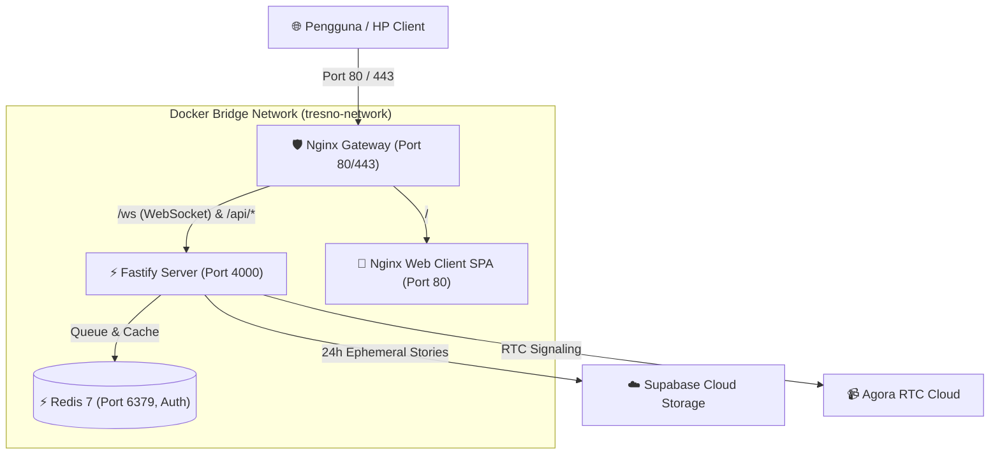

# 🚀 Panduan Deployment Docker untuk VPS - Tresno

Panduan ini berisi langkah-langkah lengkap untuk men-deploy aplikasi **Tresno** (Backend Fastify, WebSocket Signaling, Redis Queue, Frontend Web, dan Nginx Gateway) ke server **VPS** (Ubuntu 22.04 / 24.04 LTS, Debian, dsb.).

---

## 🏛️ Arsitektur Kontainer di VPS



---

## 📋 1. Persyaratan Awal (Prerequisites)

1. **Spesifikasi VPS Minimum**:
   - 1 vCPU, 1 GB RAM (Rekomendasi: 2 GB RAM + 2 GB Swap).
   - Sistem Operasi: **Ubuntu 22.04 / 24.04 LTS**.
2. **Install Docker & Docker Compose** di VPS:
   ```bash
   curl -fsSL https://get.docker.com | sh
   sudo usermod -aG docker $USER
   ```

---

## 🚀 2. Langkah-Langkah Deployment (1-Click)

### Langkah 1: Clone Repository ke VPS
```bash
git clone https://github.com/username/tresno.git /var/www/tresno
cd /var/www/tresno
```

### Langkah 2: Konfigurasi Environment Variables Produksi
Periksa dan sesuaikan file `apps/server/.env.production`:
```bash
nano apps/server/.env.production
```
Pastikan kredensial Agora (`AGORA_APP_ID`, `AGORA_APP_CERTIFICATE`) dan Supabase (`SUPABASE_URL`, `SUPABASE_SERVICE_ROLE_KEY`) terisi dengan data asli.

### Langkah 3: Eksekusi Script Deployment
```bash
chmod +x deploy.sh
./deploy.sh
```
Atau jalankan langsung via Docker Compose:
```bash
docker compose up -d --build
```

---

## 🔒 3. Setup SSL Gratis (HTTPS & WSS)

### Opsi A: Menggunakan Cloudflare (Paling Mudah & Rekomendasi)
1. Arahkan DNS domain Anda (misal `app.tresno.id`) ke **IP Publik VPS** di dashboard Cloudflare (aktifkan tanda awan oranye / *Proxied*).
2. Di menu **SSL/TLS** Cloudflare, pilih mode **"Full"** atau **"Flexible"**.
3. Selesai! Domain otomatis memiliki SSL/HTTPS aktif tanpa perlu install Certbot di VPS.

### Opsi B: Menggunakan Certbot (Let's Encrypt Langsung di VPS)
Jika tidak menggunakan Cloudflare proxy:
```bash
sudo apt install certbot -y
sudo certbot certonly --standalone -d domainanda.com
```
Lalu pasang path certificate ke dalam `gateway/nginx.conf`.

---

## 🛠️ 4. Perintah Operasional Sehari-hari

| Perintah | Fungsi |
| :--- | :--- |
| `docker compose ps` | Melihat status kesehatan semua kontainer. |
| `docker compose logs -f` | Memantau seluruh live logs (Backend, Nginx, Redis). |
| `docker compose logs -f server` | Memantau log backend Fastify & WebSocket saja. |
| `docker compose restart` | Merestart seluruh layanan. |
| `docker compose down` | Menghentikan seluruh kontainer tanpa menghapus data Redis. |
| `git pull && docker compose up -d --build` | Melakukan update aplikasi ke versi terbaru. |

---

## 🛡️ Keamanan Bawaan Docker VPS Tresno
- **Non-Root Execution**: Backend server berjalan di bawah user Linux non-root (`USER node`).
- **Password Protected Redis**: Redis hanya dapat diakses dalam jaringan internal docker dengan sandi kuat.
- **Rate-Limiting Nginx**: Mencegah serangan DDoS / spam brute-force pada endpoint API.
- **50M Client Max Body Size**: Menjamin upload story foto/video 24 jam ke Supabase berjalan lancar tanpa kendala *413 Payload Too Large*.
